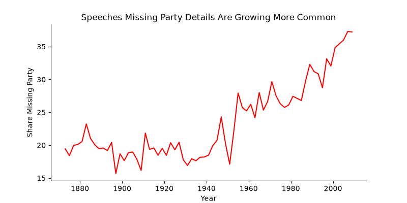
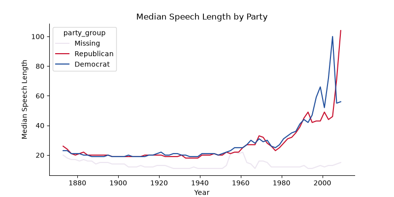
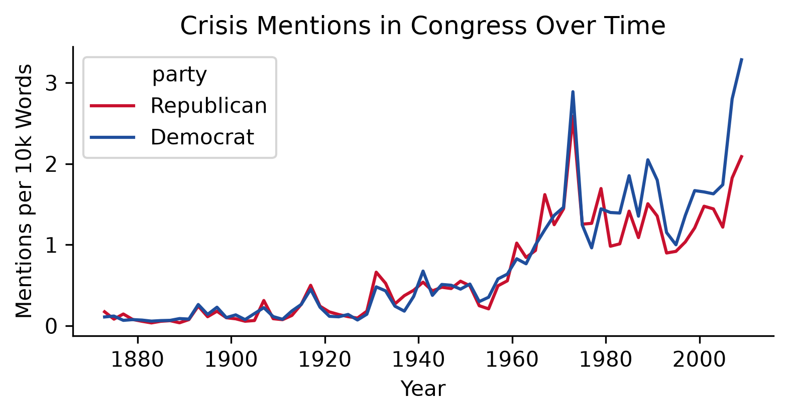
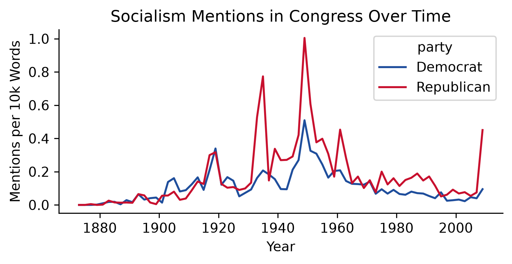
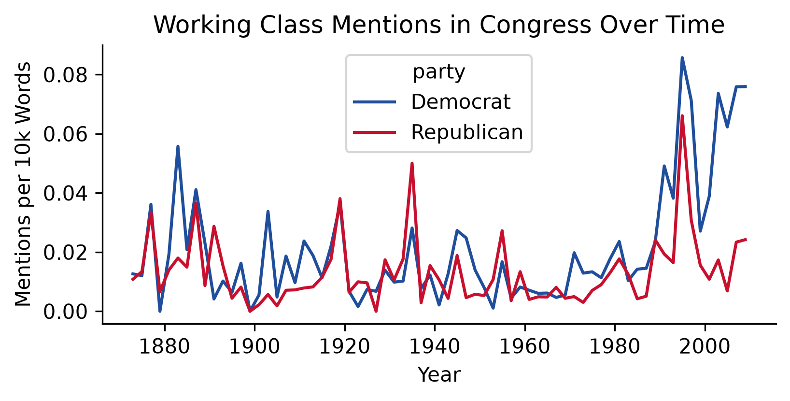

# Partisan Congressional Speech Analysis
QSS 20 Final Project by Cooper, Sheba, and Renee. 
How does partisan rhetoric in congress diverge over time? 

## Introduction

This project seeks to understand how political rhetoric in congress has evolved differently over time for the two parties, examining when certain topics became political and how that is reflected in the speech record. 

We are studying a body of congressional speech that covers the 43rd through 111th congresses, (1873 - 2011), and we are analyzing it using text-as-data methods. 

We hope to be able to answer questions such as: 
- when did division appear on major issues?
- having existing divions ever weakened over time? 
- when did certain topics become partisan? 

## Repository Structure
```
qss20_project
│
├── data/
│   ├── raw/
│   │   ├── speakermap
│   │   │
│   │   └── us_congressional_speeches
│   │
│   ├── derived/
│   │    ├── congress.duckdb
│   │    ├── speakermap.duckdb
│   │    └── speakermap.parquet
│   │
│   │
│   └── data_str.md
│
├── code/
│   ├── 01_data_pull.py
│   ├── 02_speaker_map_pull.py
│   ├── 03_speakers.ipynb
│   ├── 04_merge.ipynb
│   ├── frequency_functions.py
│   ├── frequency_graphs.ipynb
│   ├── graphs.py
│   ├── hf_speeches_check.py
│   ├── paths.py
│   └── summary_stats.ipynb
│
├── figures/
│   └── output graphs (many files)
│
├── setup.md
```

## File purposes

| Location | Purpose |
| -------- | -------- |
| data/raw/speakermap  | Contains the raw speaker metadata files, which is split into 68 txt files, one for each congress. Not tracked by git.  | 
| data/raw/us_congressional_speeches  | Contains raw speech files, split up amongst 28 parquet files. Not tracked by git.  | 
| data/derived/congress.duckdb  | Contains the merge tables that bring the entire corpus together. Most analysis starts here. Also includes one saved table, everything_but_speeches, that contains the full database without the text.  | 
| data/data_str.md  | Contains a breakdown of our data organization  | 
| code/01 and 02  | Data pulling scripts that can be run once, following the instructions in setup.md, to pull the necessary data.  | 
| code/03_speakers.ipynb  | This code file combines our speaker map files into one database.  | 
| code/04_merge.ipynb | This code file merges the two databases into one duckdb view, speeches_merged  | 
| code/paths.py  | Contains hardcoded folder references to solve path issues  | 
| code/frequency_functions.py  | Defines code that counts the frequency of certain terms in each congress  | 

## Methods and Findings (so far)

**Missing Data** 


Many of the speeches in the corpus are missing information on party, which makes our party analysis more challenging. However, we believe that many of these entrances are likely procedural speech or presiding officers. 

**Speech Length**


We can clearly see here that well speech length has been rising for members of both parties, the speeches that are missing party are both shorter and haven't been changing over time, suggesting that much is procedural. 

#### **Term Frequency Over Time**





Initial analysis into the frequency with which certain terms and phrases have been used by the two parties over time yields some interesting results. Crisis framing has become much more common, suggesting increased polarization. Socialism, always a mroe common phrase used by the right than the left, peaked in the 1950s, and is on the rise again. Both parties have tried to appeal to the working class, but with a sharp divide in usage since 2000, with the left embracing the term whilst the right stopped using it as frequently. 

## Requirements

- Python 
- Pandas
- duckdb 
- matoplotlib
- seaborn
- huggingface_hub
- jupyter
- ipykernel
