# Partisan Congressional Speech Analysis
QSS 20 Final Project by Cooper, Sheba, and Renee. 

How did partisan rhetoric in congress diverge over time? 
Sources: 
- Hugging Face Eugleo/us-congressional-speeches (https://huggingface.co/datasets/Eugleo/us-congressional-speeches)
- Stanford's Congressional Record hein-bound speaker maps (Gentzkow, Shapiro & Taddy) (https://data.stanford.edu/congress_text)

## Introduction

This project seeks to understand how political rhetoric in the US Congress has evolved differently over time for two parties (Democrats and Republicans), examining when certain topics became political and how that is reflected in the speech record. 

We are studying a body of congressional speech that covers the 43rd through 111th Congresses, (1873-2011), and we are analyzing it using text-as-data methods. 

We hope to be able to answer questions such as: 
- When did partisan division appear on major issues?
- Have existing divisions ever weakened over time? 
- When did certain topics become partisan? 

## Repository Structure
```
qss20_project
│
├── data/
│   ├── raw/ (not tracked)
│   │   ├── speakermap/
│   │   └── us_congressional_speeches/
│   └── derived/ (not tracked)
│       ├── speakermap.duckdb
│       ├── speakermap.parquet
│       ├── congress.duckdb
│       ├── logit_scores.csv
│       ├── logit_scores_10x.csv
│       ├── model_words.parquet
│       ├── topic_logit_scores.csv
│       └── topic_word_coefs.parquet
│
├── code/
│   ├── paths.py
│   ├── 01_data_pull.py
│   ├── 02_speaker_map_pull.py
│   ├── 03_speakers.ipynb
│   ├── 04_merge.ipynb
│   ├── summary_stats.ipynb
│   ├── frequency_functions.py
│   ├── frequency_graphs.ipynb
│   ├── graphs.py
│   ├── prediction.ipynb
│   ├── prediction_smooth.py
│   ├── topic_party_prediction.py
│   └── term_analysis.ipynb
│
├── figures/
│   ├── (summary figures)
│   ├── frequency/
│   ├── modelfigs/
│   ├── topicfigs/
│   └── wordfigs/
│
├── setup.md
└── README.md
```

## Run Order and Dependencies
see setup.md for detailed instructions. 
1. Download `hein-bound.zip` from Stanford (see `setup.md`) and place it in `data/raw/`.
2. Run the numbered files in order: `01_data_pull.py`, `02_speaker_map_pull.py`, `03_speakers.ipynb`, `04_merge.ipynb`. (`01_data_pull.py` and `02_speaker_map_pull.py` must be run from the project root folder)

The remaining files can then be run, as long as the files they depend on have already been run:

| File | Requires |
|---|---|
| `summary_stats.ipynb` | `04_merge.ipynb` |
| `frequency_graphs.ipynb` | `04_merge.ipynb` |
| `graphs.py` | `04_merge.ipynb` |
| `prediction.ipynb` | `04_merge.ipynb` |
| `prediction_smooth.py` | `04_merge.ipynb` |
| `topic_party_prediction.py` | `04_merge.ipynb` |
| `term_analysis.ipynb` | `prediction_smooth.py`, `topic_party_prediction.py` |


Only one file can use `congress.duckdb` at a time. The files close their connections after using them, but if a notebook leaves it open, you will not be able to access the db from other files until it is closed. Run one script at a time. 

## File purposes

| Location | Purpose |
| -------- | -------- |
| data/raw/speakermap  | Contains the raw speaker metadata files, which is split into 69 txt files, one for each congress. Not tracked by git.  | 
| data/raw/us_congressional_speeches  | Contains raw speech files, split up amongst 28 parquet files (about 6.4 gb). Not tracked by git.  | 
| data/derived/congress.duckdb  | Contains the merged db view tables that bring the entire corpus together. Most analysis starts here. Includes speeches_merged, our primary view, as well as one saved table, everything_but_speeches, that contains the full database without the text.  | 
| data/derived/ (csv and parquet files) | Model outputs: accuracy scores and word saves. Not tracked by git. |
| code/01 and 02  | Data pulling scripts that can be run once, following the instructions in setup.md, to pull the necessary data.  | 
| code/03_speakers.ipynb  | This code file combines our speaker map files into one database.  | 
| code/04_merge.ipynb | This code file merges the two databases into one duckdb view, speeches_merged  | 
| code/paths.py  | Contains hardcoded folder references to solve path issues  | 
| code/frequency_functions.py  | Defines code that counts the frequency of certain terms in each congress  | 
| code/summary_stats.ipynb | Computes basic summary stats across the corpus. |
| code/frequency_graphs.ipynb | tests frequency functions, plots abortion mentions over time |
| code/graphs.py | Plots frequency by topic and party for a large collection of word groups |
| code/prediction.ipynb | First Logit Prediction Model |
| code/prediction_smooth.py | Refined Logit party prediction model: Saves scores, words, and graphs accuracy over time. |
| code/topic_party_prediction.py | Topic Specific logit models (immigration, tariff, abortion, etc), relative to a baseline |
| code/term_analysis.ipynb | Word analysis into most partisan words over time, recently, and how certain words have evolved. Both overall and topic-specific models |
| figures/frequency, modelfigs, topicfigs, wordfigs | Figure output folders, separated by topic |


## Methods and Findings

#### **Median Speech Length**
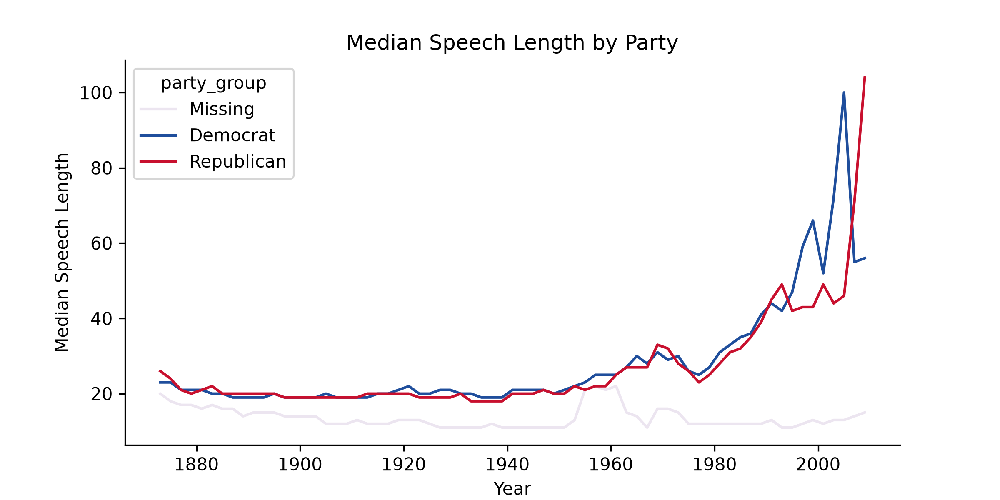

About 23% of speeches are missing party metadata. We can clearly see here that while speech length has been rising for members of both parties, the speeches that are missing party are both shorter and haven't been changing over time, suggesting that much of that is procedural. 

#### **Term Frequency Over Time**

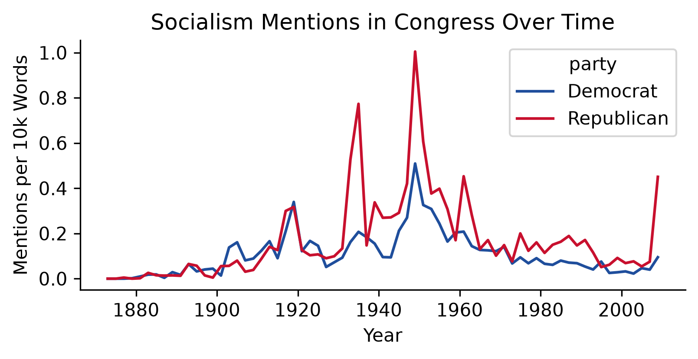
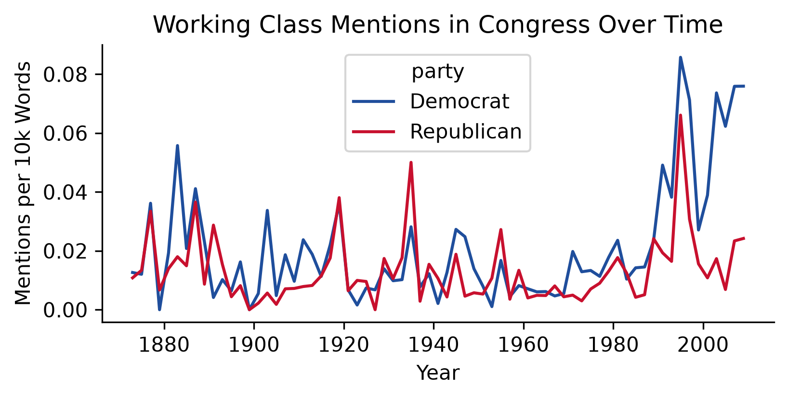

Frequency Analysis: Word Usage Tracks events more than partisanship. Topic frequency alone is not enough to differentiate the parties, as the parties tend to talk about the same things at the same time. 

#### **Logit Prediction**
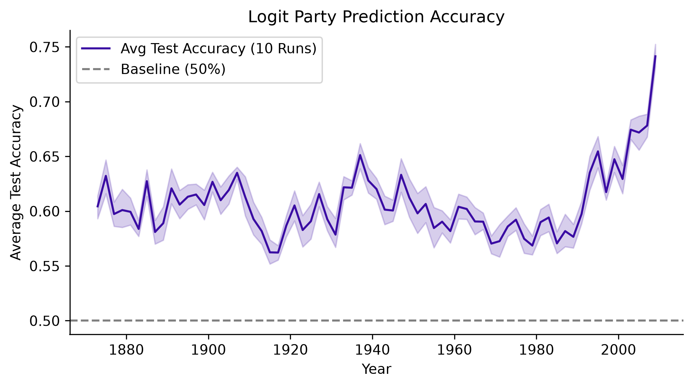

Logistic Regression Party Prediction: A logistic model fit on a TF-IDF matrix for each congress gets more accurate at predicting party in recent decades, suggesting language became more partisan since the mid 1990s, and predicting party from rhetoric became easier. 

#### **Topic Predictions**
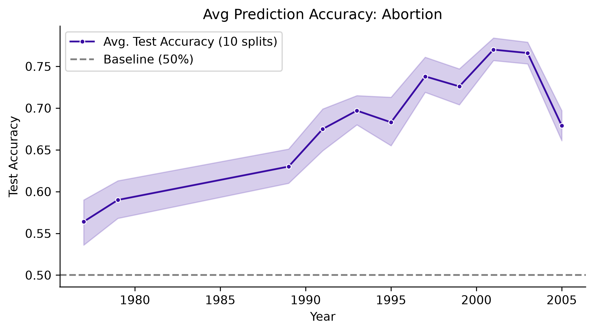
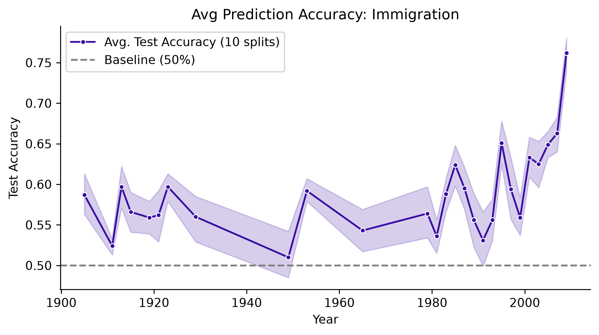
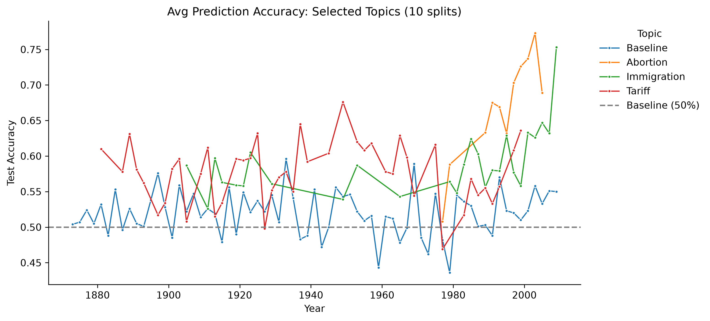

Restricting our samples to speeches that discuss certain topics, we can see that partisan language surrounding topics like abortion and immigration has become more identifiable in recent years than it was historically, but that overall, these models are not that reliable at predicting party. Sample size is small, but the models for abortion and immigration do clearly beat the baseline. 

#### **Partisan Words**

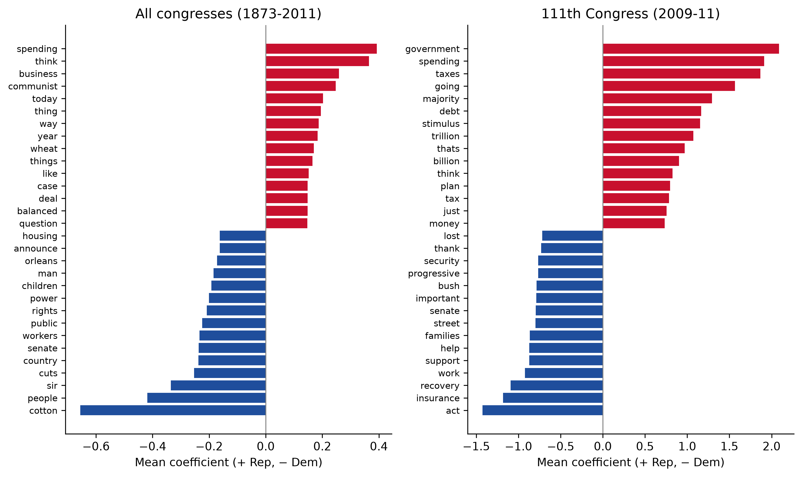
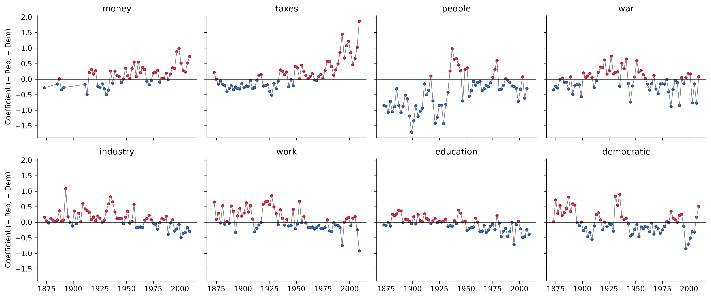

<p align="center">
  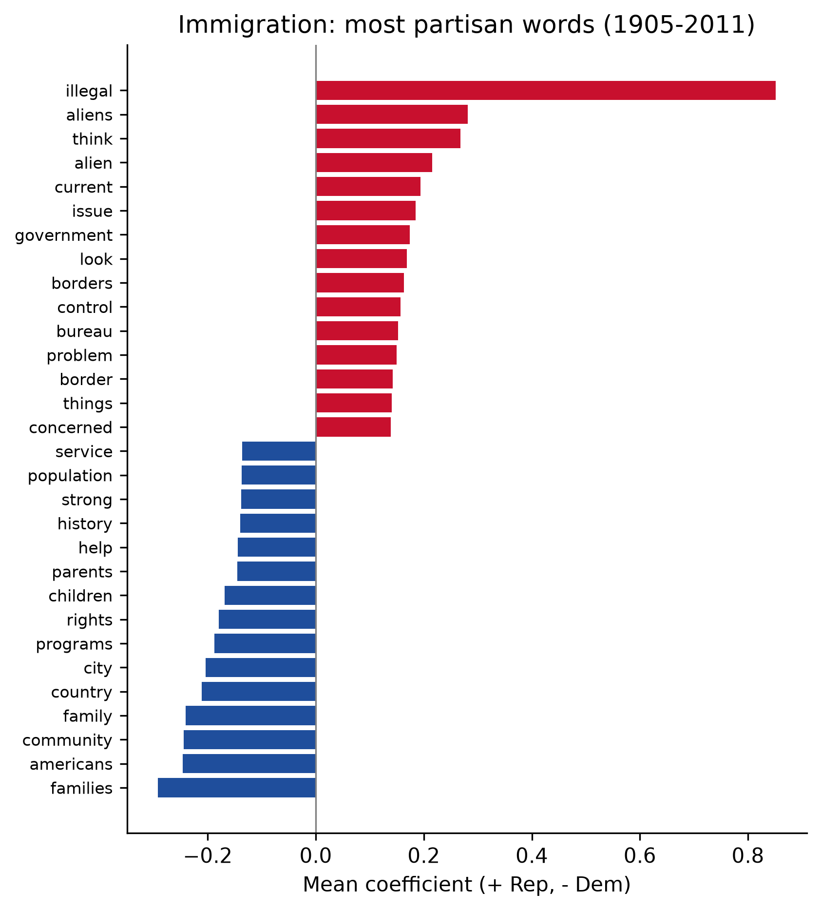
  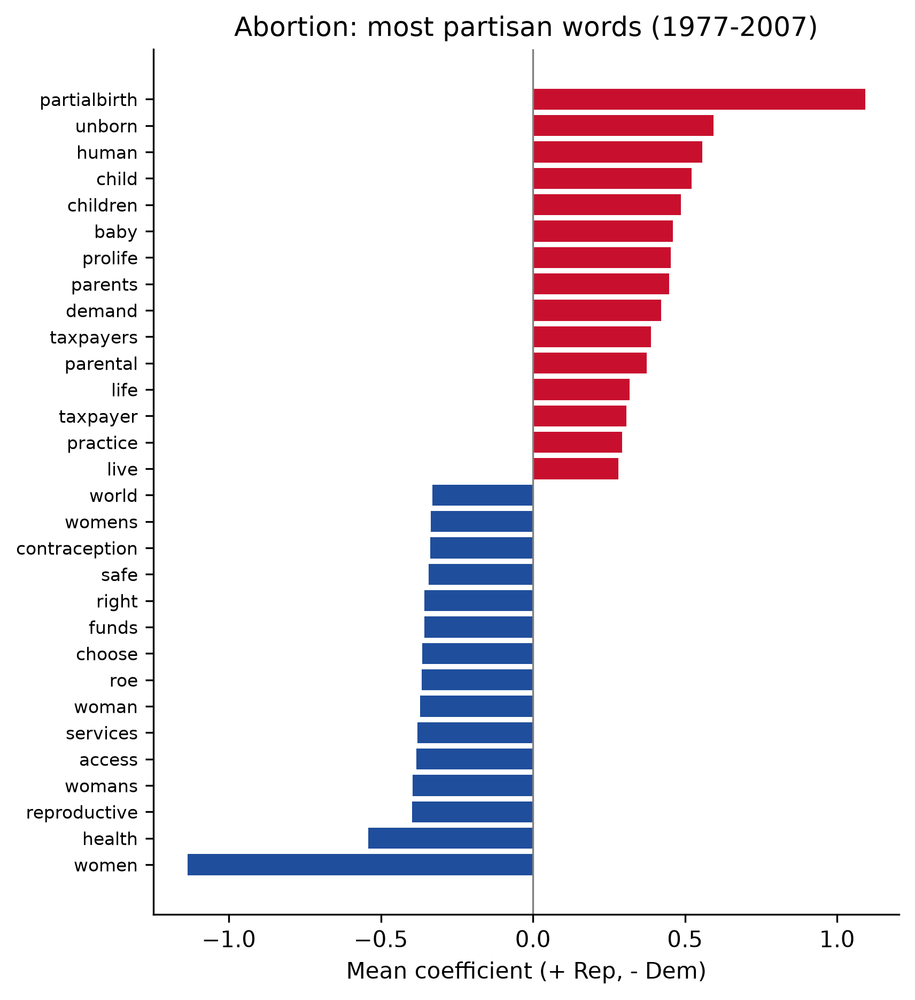
</p>

The prediction models identify words with strong weights one way or another that make the model more likely to select Republican or Democrat, all else equal. These terms clearly show ideological divergence between the two parties, and also communicate how it has become more prevalent in recent decades. 

## Requirements

- Python 
- Pandas
- duckdb 
- matplotlib
- seaborn
- huggingface_hub
- jupyter
- ipykernel
- scikit-learn
- pyarrow

#### AI Disclaimer 

We used AI tools (Claude Opus 5.5) as a general coding assistant to help us work through problems, helping with debugging, script review, code improvements, and general assistance. All decisions were reviewed and made by the group. 
